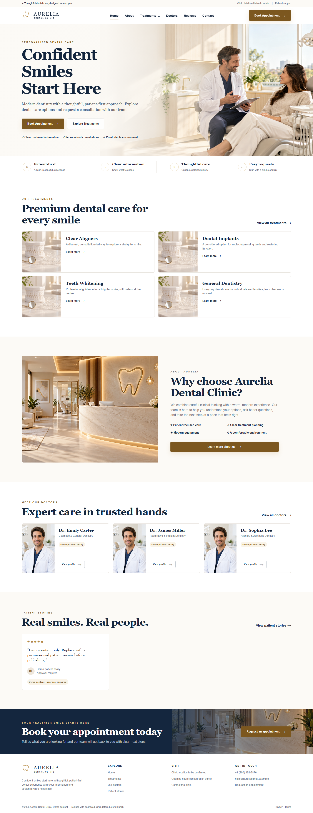
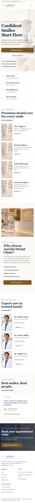
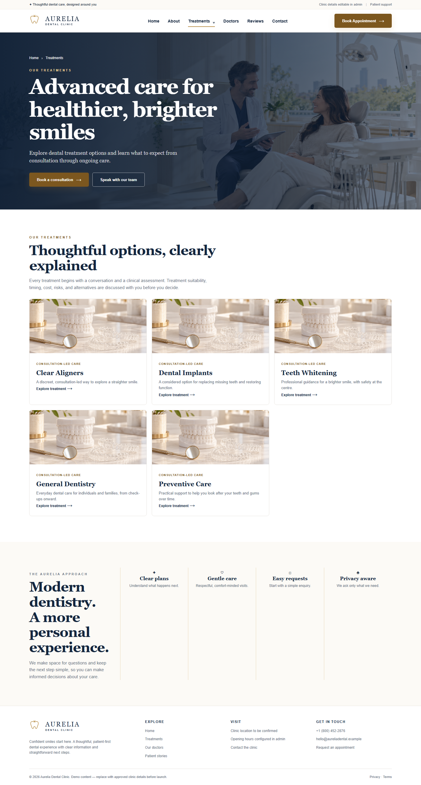
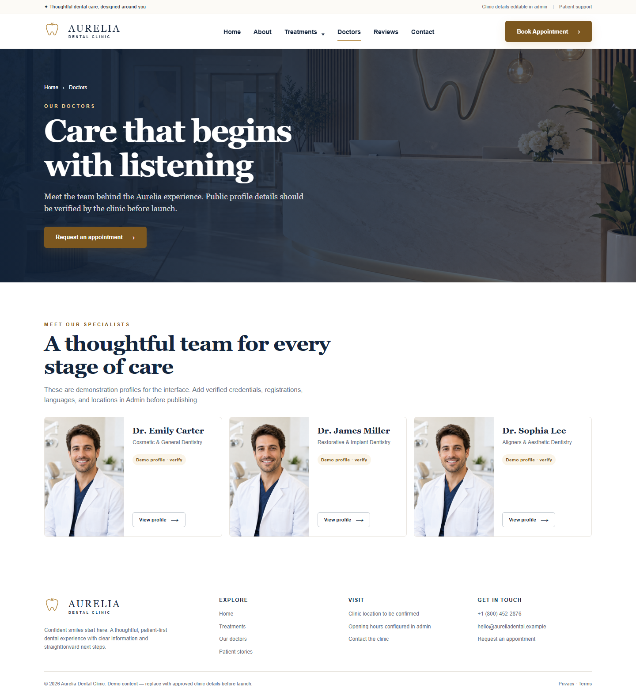
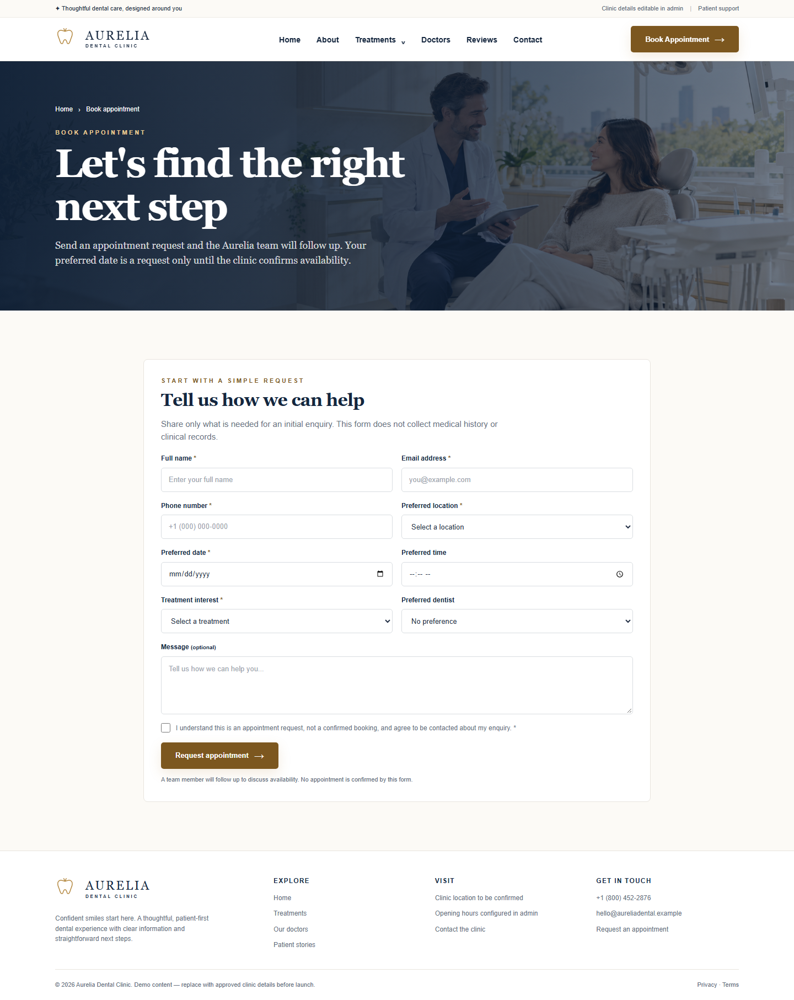
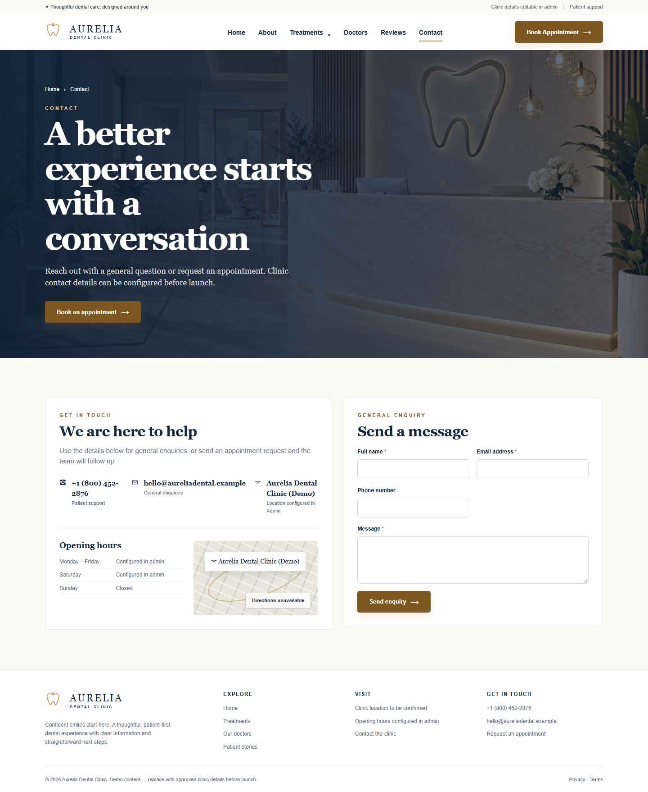
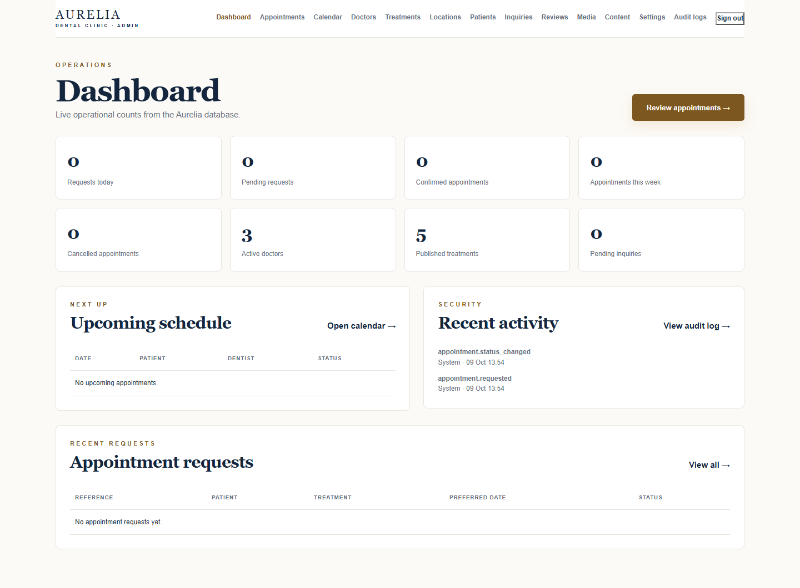

# Aurelia Dental Clinic

### Exceptional dental care. A thoughtful digital experience.

Modern dental service discovery and clinic operations software built with Laravel, Blade, Eloquent, Vite, and a responsive editorial interface.

[Overview](#overview) · [Features](#features) · [Showcase](#showcase) · [Architecture](#architecture) · [Getting started](#getting-started)

> **Project status:** The application is a verified, locally runnable implementation with demo content and generated demo imagery. It is not presented as a live clinic, a medical-record system, or a regulatory-compliance certification.

## Overview

Aurelia Dental Clinic is a premium dental healthcare website and clinic operations application. It began as a visual prototype and is now backed by Laravel routes, Blade views, Eloquent models, database migrations, server-side workflows, and an authenticated admin surface.

The product is split into two clear experiences:

- **Public experience:** treatment discovery, doctor profiles, patient-friendly service information, reviews, contact enquiries, and appointment requests.
- **Operations experience:** authenticated dashboards for appointment triage, scheduling, availability, content management, patient contact records, media, settings, and audit activity.

The visual system uses an ivory and pearl-white canvas, deep medical navy, accessible dark gold accents, editorial serif headings, and restrained motion. The result is designed to feel calm, premium, and trustworthy without obscuring the important boundary between an appointment request and a confirmed appointment.

## At a glance

| Area | Verified implementation |
| --- | --- |
| Public pages | Homepage, treatments, treatment details, doctors, doctor details, reviews, contact, booking, privacy, terms, and accessibility pages |
| Appointment flow | Server-side request persistence with validation, CSRF, throttling, honeypot protection, unique reference, REQUESTED status, and status history |
| Admin access | Session authentication, role checks, permission middleware, policies, logout/session invalidation, and audit records |
| Operations | Dashboard counts, appointment search/filter/detail/status flow, calendar, availability, blocks, CMS sections, media, locations, reviews, inquiries, settings, and patient contact records |
| Data layer | Eloquent ORM, migrations, seeders, MySQL configuration, and isolated SQLite test coverage |
| Frontend | Blade templates, custom CSS, small vanilla JavaScript layer, Vite asset pipeline, responsive navigation, reduced-motion support, and accessible form feedback |
| Verification | PHPUnit, Playwright Chromium smoke/responsive checks, axe-core public-page audit, keyboard booking-form check, Blade cache, route compilation, and production asset build |

## Features

### Patient experience

- Database-backed homepage with configurable content sections.
- Treatment listing and slug-based treatment detail pages.
- Doctor listing and slug-based doctor profile pages.
- Public review display with moderation and permission-aware publishing rules.
- Contact form that persists enquiries for staff follow-up.
- Appointment request form with treatment, doctor, location, date, time, contact, message, and privacy acknowledgement fields.
- Appointment requests return a unique reference and remain explicitly unconfirmed until staff action.
- Public privacy, terms, and accessibility pages.
- Responsive layouts tested across desktop and mobile viewport matrices.

### Clinic operations

- Protected admin login/logout flow.
- Role-aware dashboard with request, appointment, doctor, treatment, inquiry, and activity summaries.
- Appointment search and filtering by reference/patient, status, dentist, treatment, location, and preferred date.
- Appointment detail, status history, status transitions, assignment, rescheduling, and duration-aware conflict checks.
- Calendar views, recurring availability, exceptional availability dates, and schedule blocks.
- Doctor, treatment, location, review, inquiry, media, CMS section, and public settings management.
- Patient contact registry with scoped access and an anonymization action.
- Doctor-owned calendar access with restricted, read-only appointment visibility.
- Audit-log viewing for operational activity.
- Queued mailables for appointment requests, appointment status changes, and inquiries when a staff recipient is configured.

### Platform and accessibility

- Laravel session authentication with role and permission gates.
- Eloquent relationships and route model binding for public and admin resources.
- Form Request validation, CSRF protection, rate limiting, honeypot fields, and minimal contact-data persistence.
- Security response headers including CSP, frame, referrer, permissions, and content-type controls.
- Contextual image alternative text, visible focus styles, role=status/role=alert feedback, reduced-motion handling, and 44px-or-larger primary touch targets.
- No custom modal dialog or patient-facing medical-record workflow is currently implemented.

## What this project does not claim

The source confirms an appointment **request** workflow, not instant or automatically confirmed booking. It does not confirm the following as implemented product claims:

- patient login accounts or a patient portal;
- electronic health records, medical history, clinical notes, or treatment records;
- online payments, insurance processing, or billing;
- a public live demo URL;
- real clinic credentials, verified practitioner biographies, licensed clinic photography, or real patient testimonials;
- HIPAA, GDPR, WCAG certification, or any other regulatory/security certification.

Demo doctors, reviews, location details, and imagery are seeded or generated placeholders and are marked for replacement before production use.

## Showcase

The images below are real Playwright captures stored in [docs/screenshots/phase-3/](docs/screenshots/phase-3/). They show the current rendered application, including its intentionally labelled demo content. No patient records or sensitive clinical information are used in these artifacts.

### Public website

| Homepage — desktop | Homepage — mobile |
| --- | --- |
|  |  |

| Treatments | Doctors |
| --- | --- |
|  |  |

| Appointment request | Contact and enquiry |
| --- | --- |
|  |  |

The repository contains treatment detail and doctor detail routes, but the current screenshot artifact set does not include separate detail-page captures. This README does not invent those images.

### Operations workspace

The admin screenshot is an authenticated visual artifact with empty appointment counts and demo content only. Access to the operations workspace is protected by Laravel authentication, role checks, and per-module permissions.

## Architecture

~~~mermaid
flowchart LR
    Browser[Public or admin browser]
    Routes[Laravel web routes]
    Public[PublicController + Blade views]
    Admin[Admin controllers + middleware]
    Models[Eloquent models and policies]
    DB[(MySQL or SQLite database)]
    Mail[Queued Laravel mail]
    Assets[Vite-built CSS and JavaScript]

    Browser --> Routes
    Routes --> Public
    Routes --> Admin
    Public --> Models
    Admin --> Models
    Models --> DB
    Public -. optional staff notification .-> Mail
    Admin -. optional staff notification .-> Mail
    Browser --> Assets
~~~

### Request lifecycle boundaries

1. Public and admin requests enter through routes/web.php.
2. Public controllers load published content through Eloquent scopes and route model binding.
3. Admin routes pass through session authentication, the admin middleware, and module-specific permission middleware.
4. Appointment requests are validated, persisted transactionally, assigned a unique reference, written to status history, and logged.
5. Staff notifications are queued only when AURELIA_STAFF_EMAIL is configured; the default local mail transport is log.

The scheduling service calculates duration-aware appointment windows, checks clinic hours, doctor availability, schedule blocks, and overlapping confirmed appointments under a doctor row lock. MySQL concurrency verification remains a pre-production task.

## Technology stack

| Layer | Technology | Purpose |
| --- | --- | --- |
| Application framework | Laravel 13.35 | Routing, HTTP lifecycle, validation, sessions, mail, queues, migrations, and testing |
| Language/runtime | PHP ^8.3 | Application and console code |
| View layer | Blade | Public and authenticated admin server-rendered UI |
| ORM | Eloquent | Models, relationships, scopes, route model binding, and persistence |
| Database | MySQL 8+ configuration; SQLite local/test fallback | Operational data, content, scheduling, audit, and queue tables |
| Styling | Custom CSS in resources/css/aurelia.css | Aurelia visual system, responsive layout, focus states, and reduced motion |
| Frontend tooling | Vite 8.3.4 + Laravel Vite plugin | Development and production asset builds |
| Browser behavior | Vanilla JavaScript | Mobile navigation, back-to-top interaction, and booking date guard |
| Verification | PHPUnit 12.5, Playwright 1.64, axe-core 4.13 | Feature tests, browser smoke/visual checks, and accessibility audit |

### Authentication and authorization

Laravel session authentication protects /admin. The application verifies admin roles, maps roles to explicit permissions, and uses policies for appointment, content, media, and patient-sensitive operations. Doctor accounts are linked to doctor records and are restricted to their own calendar visibility.

### Integrations

- Google Fonts are referenced by the Blade layout for DM Sans and Playfair Display.
- Laravel Mail supports queued appointment and inquiry notifications; local configuration uses the log mailer.
- Local demo imagery is stored under public/images/ and is documented in [docs/IMAGE_ASSET_MANIFEST.md](docs/IMAGE_ASSET_MANIFEST.md).
- No payment gateway, maps SDK, analytics service, external CMS, or external patient system is wired in the verified source.

## Project structure

~~~text
app/
├─ Console/Commands/              # First-admin creation command
├─ Http/Controllers/              # Public and admin request orchestration
├─ Http/Middleware/               # Admin, permission, and security controls
├─ Http/Requests/                 # Appointment validation boundary
├─ Mail/                          # Queued notification mailables
├─ Models/                        # Eloquent domain models and relationships
├─ Policies/                      # Resource authorization policies
└─ Services/Scheduling/           # Availability and conflict checks
database/
├─ migrations/                    # Core Laravel + Aurelia schema
└─ seeders/                       # Demo content and roles
resources/
├─ css/aurelia.css                # Design system and responsive UI
├─ js/aurelia.js                  # Small progressive-enhancement layer
└─ views/                         # Public, admin, partial, layout, and mail views
routes/web.php                    # Public and protected web routes
public/images/                    # Local demo assets
docs/screenshots/phase-3/         # Playwright visual artifacts
tests/
├─ Feature/                       # HTTP, persistence, RBAC, scheduling, CMS tests
└─ e2e/                           # Playwright public, visual, and accessibility tests
~~~

Generated dependencies, caches, compiled output, and local storage are intentionally omitted from this overview.

## Getting started

### Requirements

- PHP 8.3+
- Composer 2+
- Node.js and npm
- MySQL 8+ for operational use, or SQLite for the local fallback/test workflow

### Install

Clone the project through the repository's configured Git remote, then enter the project directory. No external remote URL is included here because one was not verifiable in the current workspace.

~~~powershell
composer install
Copy-Item .env.example .env
php artisan key:generate
npm install
~~~

### Configure the environment

.env.example is the safe local template. Never commit .env, credentials, API keys, or mail secrets.

For SQLite development, use an existing database/database.sqlite file or create an empty one, then configure:

~~~dotenv
APP_URL=http://127.0.0.1:8000
DB_CONNECTION=sqlite
DB_DATABASE=database/database.sqlite
AURELIA_DEMO_CONTENT=true
MAIL_MAILER=log
~~~

For MySQL-backed operation, set DB_CONNECTION=mysql together with the verified DB_HOST, DB_PORT, DB_DATABASE, DB_USERNAME, and DB_PASSWORD values for a disposable or approved database. The setup documentation uses aurelia_dental for development and aurelia_dental_test for isolated MySQL test runs.

The project reads these application-specific variables:

| Variable | Use |
| --- | --- |
| AURELIA_DEMO_CONTENT | Enables the demo-content boundary used by the local seed data |
| AURELIA_STAFF_EMAIL | Optional recipient for queued appointment and inquiry notifications |
| AURELIA_FROM_EMAIL | Notification sender address |
| AURELIA_FROM_NAME | Notification sender name |

### Migrate and seed

~~~powershell
php artisan migrate --seed
~~~

The seeder creates demo roles, treatments, doctors, a demo location, and a demo review. Replace or remove these records before any real clinic deployment.

### Create an administrator

The command prompts for a password when one is not supplied and does not store a hardcoded credential in the repository.

~~~powershell
php artisan aurelia:create-admin admin@example.com --name="Clinic Administrator"
~~~

Then open /admin/login and sign in with the local credentials you created.

### Build and run

~~~powershell
npm run build
php artisan serve
~~~

The default local address is http://127.0.0.1:8000 when APP_URL is configured as shown above.

For queued notifications in an approved staging environment, run a worker after configuring a real queue and mail transport:

~~~powershell
php artisan queue:work --tries=3
~~~

## Verification

The following checks were run against the current workspace on 2026-10-14:

| Check | Result |
| --- | --- |
| npm.cmd run build | Passed — Vite 8.3.4 production build |
| php artisan view:cache | Passed |
| php artisan migrate:status | Passed — migrations through 2026_10_09_000012_add_exceptional_availability_dates are applied to the local SQLite database |
| npm.cmd run test:e2e -- --workers=1 | Passed — 10 tests passed, 8 skipped by project/credential guards |
| php artisan test | Partial — 22 tests passed and 1 failed in test_availability_and_schedule_blocks_are_manageable_and_enforced because the SQLite assertion expects a date-only value while the stored value is represented as a datetime |

The PHPunit failure is documented rather than hidden. It is a test/database date-casting compatibility issue observed during this audit; no business logic was changed to make the README appear green.

The browser suite also confirms the public homepage/navigation, contact and booking controls, unauthenticated admin redirect, mobile menu interaction, public axe-core accessibility checks, booking-form keyboard progression, and responsive overflow checks. Credential-gated authenticated workflow tests remain opt-in and are not claimed as part of the default run.

Additional implementation and release evidence is available in:

- [docs/PHASE_3_COMPLETION_REPORT.md](docs/PHASE_3_COMPLETION_REPORT.md)
- [docs/PHASE_3_TEST_RESULTS.md](docs/PHASE_3_TEST_RESULTS.md)
- [docs/PHASE_3_ACCESSIBILITY_REVIEW.md](docs/PHASE_3_ACCESSIBILITY_REVIEW.md)
- [docs/PHASE_3_SECURITY_REVIEW.md](docs/PHASE_3_SECURITY_REVIEW.md)
- [docs/PHASE_3_DEPLOYMENT_CHECKLIST.md](docs/PHASE_3_DEPLOYMENT_CHECKLIST.md)
- [docs/LARAVEL_SETUP.md](docs/LARAVEL_SETUP.md)

## Roadmap

### Completed

- Responsive Aurelia public website with Blade layouts, reusable partials, and local demo assets.
- Database-backed treatments, doctors, locations, reviews, content sections, and public settings.
- Appointment request persistence with REQUESTED state, status history, reference generation, and staff-notification hooks.
- Contact enquiry persistence and admin triage.
- Authenticated admin workspace with role/permission boundaries.
- Appointment management, calendar, availability, schedule blocks, and conflict checks.
- Doctor, treatment, location, review, media, CMS, patient contact, settings, and audit-log modules.
- Playwright responsive captures and public accessibility checks.

### In progress / verification required

- Resolve the current SQLite date-casting assertion in the availability feature test and rerun the complete PHPUnit suite.
- Complete manual accessibility review across the final browser/device matrix, including calendar keyboard behavior.
- Run MySQL Phase 3 integration and concurrency verification against the isolated test database.
- Validate queued mail delivery, worker recovery, HTTPS headers, CSP behavior, and staging configuration.

### Planned before production

- Replace seeded demo content, generated imagery, placeholder contacts, and fictional practitioner profiles with clinic-approved assets and copy.
- Complete jurisdiction-specific privacy/legal review, retention/deletion workflows, backup/restore checks, monitoring, and access review.
- Confirm image licensing, production media optimization, and final content accessibility.
- Establish a verified deployment pipeline and an approved remote repository/demo link if one is to be shared publicly.

## Security and privacy

The source contains the following verified controls:

- CSRF protection on state-changing forms.
- Session authentication with session regeneration on login and invalidation on logout.
- Role and permission middleware for admin modules.
- Explicit resource policies for appointments, content, media, and patient access.
- Password hashing through Laravel authentication.
- Rate limiting on admin login, contact enquiries, and appointment requests.
- Honeypot fields on public forms.
- Input validation, published/active relationship checks, and transactional persistence.
- Minimal patient contact fields for the request workflow rather than medical history or clinical records.
- Hashed source IP storage for appointment-request audit context.
- Audit-log records for administrative activity.
- Secure media validation and usage checks.
- Security response headers including CSP, X-Frame-Options, X-Content-Type-Options, Referrer-Policy, and Permissions-Policy.

These controls do not constitute HIPAA, GDPR, WCAG, or security certification. Before processing real patient information, complete the deployment checklist, approved privacy review, production HTTPS/mail/queue configuration, retention policy, backup/restore testing, MySQL concurrency testing, and human security review.

## Demo content and image licensing

Local images under public/images/ are generated demo assets documented in [docs/IMAGE_ASSET_MANIFEST.md](docs/IMAGE_ASSET_MANIFEST.md). They are not clinic photography, verified practitioner portraits, or clinical outcome photography. Replace them with approved, licensed, optimized media before publication.

The seeded review explicitly says it is demo content and requires approval. The seeded doctor profiles are fictional placeholders and must not be presented as real clinicians.

## License

The project metadata declares the MIT license. No LICENSE file is present in the current workspace; add the approved license text before publishing the project publicly.

**AURELIA DENTAL CLINIC**  
Thoughtful Care. Confident Smiles.

[Back to top](#aurelia-dental-clinic) · [Repository root](.)

